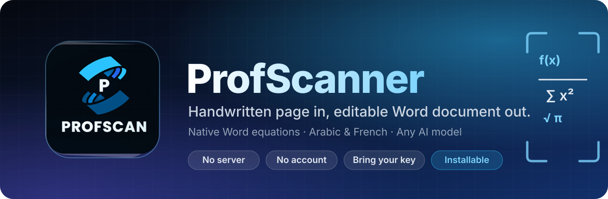
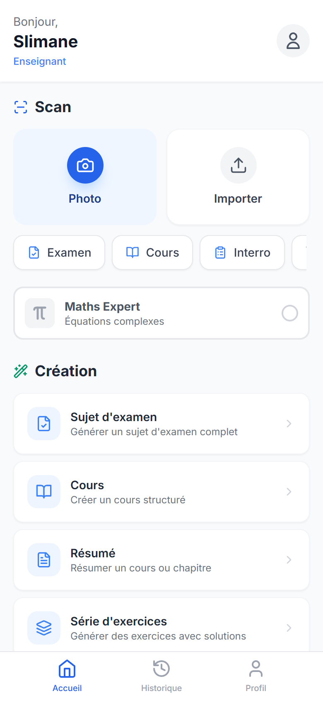
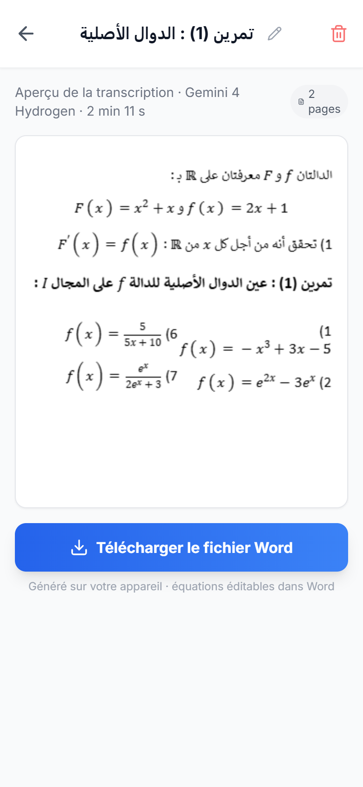
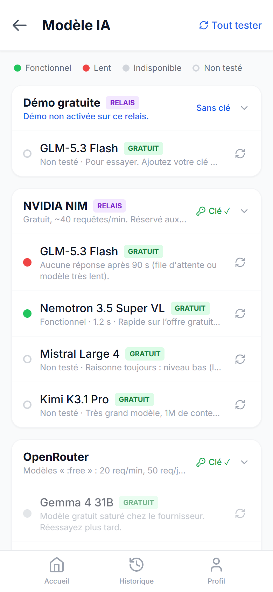
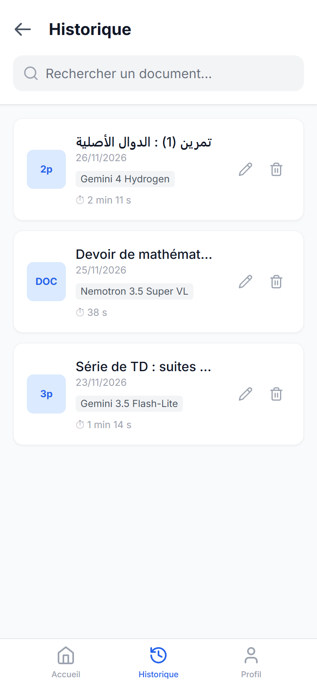
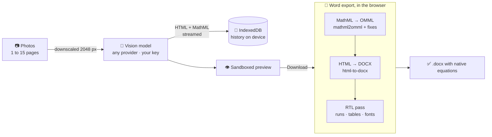

<div align="center">



<br>


**Take a photo of a handwritten exam, an exercise sheet or a correction.**<br>
**Get back a `.docx` you can keep editing in Word, with real equations.**

**[▶ Try it live](https://profscanner.netlify.app)** · [Download](#️-try-it-or-download-it) · [Quick start](#-quick-start) · [Install on your phone](#-install-it-on-your-phone-full-screen) · [Choose a model](#-any-ai-model-your-key) · [How it works](#-how-it-works) · [Roadmap](#-roadmap)

</div>

---

## 📱 See it

<div align="center">
<table>
<tr>
<td align="center"><picture><source media="(prefers-color-scheme: dark)" srcset="docs/screens/home-dark.png"></picture><br><sub><b>Scan</b><br>photo or import</sub></td>
<td align="center"><picture><source media="(prefers-color-scheme: dark)" srcset="docs/screens/result-dark.png"></picture><br><sub><b>Preview</b><br>Arabic + math, then <i>Download Word</i></sub></td>
<td align="center"><picture><source media="(prefers-color-scheme: dark)" srcset="docs/screens/models-dark.png"></picture><br><sub><b>Any model</b><br>live status dots</sub></td>
<td align="center"><picture><source media="(prefers-color-scheme: dark)" srcset="docs/screens/history-dark.png"></picture><br><sub><b>History</b><br>model + scan time</sub></td>
</tr>
</table>
</div>

## ✨ Why it exists

Turning a handwritten math sheet into a clean Word file is slow, manual work: retyping the text, rebuilding every fraction in the equation editor, redoing the layout. Generic OCR is bad at handwriting and worse at math. And when it does output math, it is LaTeX or an image, neither of which a teacher can edit in Word.

ProfScanner chains a **vision AI** and a **custom Word generator** so that the result is the same page, typed properly:

|  |  |
|---|---|
| 🧮 **Native Word equations** | Fractions, roots, limits, sums, systems of equations: real OMML objects you can click and edit, not pictures. |
| 🌍 **Arabic, French and English together** | Right-to-left text, inline formulas inside Arabic sentences, mixed-direction tables, all laid out correctly. |
| 🎨 **Layout kept** | Headings, boxed text, tables, side-by-side columns, pen colors, highlighting, grading marks. |
| 🔌 **Any AI model** | NVIDIA, Google, OpenRouter, Mistral, Anthropic… or any OpenAI-compatible endpoint, even a local Ollama. |
| 🔒 **Private by design** | No server, no account. Profile, history and keys stay in your browser. |
| 📲 **Installable** | Add it to your home screen: full screen, no browser bars, works offline for the interface. |

> **Status: beta.** It works on real exam sheets, but quality depends on the photo and on the model you pick. See [Limitations](#-limitations).

---

## ⬇️ Try it or download it

| | |
|---|---|
| ▶ **Live demo** | **[https://profscanner.netlify.app](https://profscanner.netlify.app)**: open it on your phone or computer, pick a model, paste your key, scan. Nothing to install. |
| 📦 **Download** | The latest build is on the **[Releases page](https://github.com/simoosh/profscanner/releases)**: `profscanner-web-<version>.zip`, a ready-to-host static site (no server, no dependencies). |

**Host the downloaded build:** unzip it and upload the folder to any static host over HTTPS (Netlify drag and drop, GitHub Pages, Cloudflare Pages, your own web server). To test it locally:

```bash
npx serve .
```

> Double-clicking `index.html` does not work: browsers refuse to load the app's modules from a `file://` address, and install and camera need HTTPS or `localhost`. The release has no relay URL built in: NVIDIA NIM and Z.ai need [your own relay](proxy/README.md) (set its URL in the app); the other providers work as is.

---

## 🚀 Quick start

**Prerequisites:** Node.js 18+ and npm.

```bash
git clone https://github.com/simoosh/profscanner.git
```

```bash
cd profscanner
```

```bash
npm install
```

```bash
npm run dev
```

Open the printed URL. The app asks for your profession and a few details, then sends you to **AI model** to pick a model and paste the key of its provider. There is **no `.env` file to configure**: keys are entered in the app.

> The dev server listens on your local network, so you can open it from a phone on the same Wi-Fi. Browsers only allow the camera on `localhost` or HTTPS: on a phone, use the gallery picker, or [deploy](#-deploy) over HTTPS.

---

## 📲 Install it on your phone (full screen)

A web page **cannot hide the browser's address bar by itself**: Chrome and Safari forbid it. What works is installing the app, which then opens in its own window with no browser bars at all.

| Device | How |
|---|---|
| **Android (Chrome)** | Tap **Install** on the banner at the top of the home screen (or **Profile → Install**). The app opens full screen from its icon. A **Full screen now** button is also available without installing. |
| **iPhone / iPad (Safari)** | Tap **Share** → **Add to Home Screen**, then open ProfScanner from the new icon. Safari has no install prompt on iOS, the banner shows these steps. |
| **Desktop (Chrome / Edge)** | Click the install icon in the address bar. |

Under the hood: a web app manifest (`standalone`, with `fullscreen` preferred), maskable icons, a service worker that caches only the interface (never scans or keys), `viewport-fit=cover` and safe-area insets for notches, and `dvh` units so layouts do not jump when the browser bars hide.

---

## 🤖 Any AI model, your key

Open **Profile → AI model**. Models are grouped by provider; tap a provider to enter its key, tap a model to select it. Each model shows a **live status**:

| Dot | Meaning |
|:---:|---|
| 🟢 | **Working**: first output arrived in under 8 s |
| 🔴 | **Slow**: first output after 8 s, or nothing after 90 s (free queues can last minutes: raise the scan timeout in Preferences) |
| ⚪ | **Unavailable**: no key, relay needed, key refused, quota reached, model retired… the reason is shown |
| ◯ | **Not tested** yet |

The status comes from real scans and from a tiny test request (a 16×16 image) that stops at the **first token**, so reasoning models that think for minutes still count as working, and free quota is barely touched.

<details>
<summary><b>Built-in providers and models</b> (free tiers change often: figures are indicative, checked November 2026)</summary>

<br>

| Provider | Vision models | Free tier | Browser calls |
|---|---|---|:---:|
| **Free demo** (your relay) | GLM-5.3 Flash | A few scans per visitor per day on the maintainer's key | via relay |
| **[NVIDIA NIM](https://build.nvidia.com)** | GLM-5.3 Flash, Nemotron 3.5 Super VL, Mistral Large 4, Kimi K3.1 Pro | ~40 requests/min, no card. *Trial terms: testing and evaluation only* | ❌ [relay](proxy/README.md) |
| **[Google Gemini](https://aistudio.google.com)** | 3.5 Flash-Lite, 3.1 Flash-Lite, 3.8 Flash, 4 Hydrogen, 3.5 Flash, 3.1 Pro | ~500 requests/day on Flash-Lite, ~20/day on Flash | ✅ |
| **[OpenRouter](https://openrouter.ai)** | Gemma 4 31B and 26B, Nemotron 3.5 Super VL (`:free`) | 20 req/min, 50 req/day, shared and often saturated | ✅ |
| **[Mistral](https://console.mistral.ai)** | Mistral Small, Pixtral Large | "Experiment" plan, requires accepting data use for training | ✅ |
| **[Z.ai](https://z.ai)** | GLM-4.6V Flash | Listed as free, but the API may require a funded account | ❌ relay |
| **[SiliconFlow](https://siliconflow.com)** | Qwen3-VL 30B | No free vision model confirmed. Keys are per site (`.com` ≠ `.cn`) | ✅ |
| **[Anthropic](https://console.anthropic.com)** | Claude Sonnet 5.5 | Paid | ✅ |

</details>

**Custom models.** **Modèle perso**, at the bottom of the list, adds any endpoint: name, protocol (OpenAI-compatible or Anthropic), base URL, model id, key, and whether to go through the relay. It covers Groq, Together, Cerebras, a self-hosted vLLM, or a local [Ollama](https://ollama.com) / LM Studio (`http://localhost:11434/v1`, no key).

**What we saw in practice** (exam sheets in French and Arabic with complex math and layout): Gemini 4 Hydrogen gave an excellent result on Arabic with complex formulas and tables; Gemini 3.5 Flash-Lite is good and generous on the free quota; Nemotron 3.5 Super VL is fast and fine for French and English math, but weak on Arabic with elaborate layout. Test with your own documents.

**Reasoning models.** Some free models "think" for many minutes before writing. The app asks them to answer directly when a provider supports it, shows the thinking progress live, and lets you set the scan timeout (5 to 60 min).

---

## 🔧 How it works



1. **Capture.** One to fifteen photos, plus optional instructions (fix spelling, add a summary…).
2. **Transcription.** Photos are downscaled and sent to the selected model with a guided system prompt (`services/apiService.ts`): analyse the page first, then write HTML from exact templates that the Word converter can render (header columns, margin grades, boxes, tables, RTL, MathML). The answer is streamed.
3. **Storage.** The result is saved on the device, with the model used and the scan duration.
4. **Preview.** Generated HTML is shown in an `<iframe sandbox="">`: it can never run scripts or reach your keys.
5. **Word export.** [`html-to-docx`](https://github.com/TurboDocx/html-to-docx) builds the file in the browser; each `<math>` goes through `services/mathConverter.ts`, which converts it with [`mathml2omml`](https://www.npmjs.com/package/mathml2omml) and repairs what that library misses: upright function names, stretchy brackets around fractions and roots, the big brace of systems of equations, stray text Word would drop.
6. **Right-to-left pass.** Arabic runs are marked RTL so digits, colons and parentheses stay in order; alignment and table columns are mirrored; complex-script bold, size and font are set.

> MathML support in html-to-docx was written for this project and proposed upstream in [TurboDocx/html-to-docx#271](https://github.com/TurboDocx/html-to-docx/pull/271). Until it is merged, a build of that branch is vendored in [`vendor/html-to-docx/`](vendor/html-to-docx/README.md).

---

## 🌐 Deploy

The live instance runs on **Netlify** (https://profscanner.netlify.app) with its relay on a **Cloudflare Worker**. To publish your own, follow the steps below.

```bash
npm run build
```

`dist/` is a fully static site: host it on GitHub Pages, Netlify, Vercel, Cloudflare Pages or any web server. It uses relative paths and a `HashRouter`, so it works from any sub-folder with no rewrite rules. It holds no secret: every visitor brings their own key. Serve it over **HTTPS** (camera, install and service worker require it).

### Optional relay: CORS + free demo

NVIDIA NIM, Z.ai, GitHub Models and SambaNova do not send CORS headers, so a browser cannot call them directly. [`proxy/`](proxy/README.md) holds a small **Cloudflare Worker** (free plan) that:

- **relays** requests to an allow-list of provider hosts and adds CORS headers. It stores nothing; the user's key passes through;
- optionally serves a **free demo**: visitors scan without any key on the maintainer's key (a Worker secret, never sent to the browser), capped per visitor per day, per day overall and per minute, with a single allowed model and capped output and request size.

```bash
VITE_PROXY_URL=https://profscanner-relay.<account>.workers.dev npm run build
```

With a relay URL in the build, new visitors land directly on the free demo. Read the safeguards and caveats (provider terms, abuse, privacy) in [`proxy/README.md`](proxy/README.md) before enabling it.

---

## 🗂 Project structure

```
├── App.tsx                     # Routes; onboarding until a local profile exists
├── components/
│   └── InstallCard.tsx         # Install / full-screen banner
├── services/
│   ├── apiService.ts           # Guided prompt, transcription call, local history, Word export entry
│   ├── ai/
│   │   ├── catalog.ts          # Built-in providers and vision models
│   │   ├── registry.ts         # Built-in + custom models, availability, selection
│   │   ├── client.ts           # OpenAI-compatible and Anthropic calls: streaming, timeout, error mapping
│   │   ├── health.ts           # Green / red / grey status from scans and first-token tests
│   │   ├── demo.ts             # Free demo status and quota left (from the relay)
│   │   └── imagePrep.ts        # Photo downscaling
│   ├── docxExport.ts           # HTML normalisation, html-to-docx, RTL post-processing
│   ├── mathConverter.ts        # MathML → OMML and repairs
│   ├── install.ts              # Install prompt and Fullscreen API
│   ├── settings.ts             # Keys, selected model, custom models, timeout, relay URL
│   ├── storage.ts              # IndexedDB stores
│   └── professionRegistry.ts   # Professions, onboarding questions, home actions
├── pages/                      # Onboarding, Home, Customize, Result, History, Models, Profile…
├── public/                     # Manifest, icons, service worker
├── proxy/                      # Cloudflare Worker: CORS relay + capped free demo
└── vendor/html-to-docx/        # html-to-docx build with MathML support (MIT), temporary
```

---

## 🔐 Privacy and security

- **Your data stays on the device.** Profile, history and settings live in the browser (IndexedDB, localStorage). *Profile → Erase all my data* wipes everything.
- **Images go only to the AI provider you selected**, through your relay if that provider needs one, when a scan starts. They are then subject to that provider's terms; some free tiers (Mistral Experiment, NVIDIA trial) may use requests to improve their models. Do not scan documents you may not share with that provider.
- **API keys are stored in plain text in the browser**, like any client-side credential. Delete them from the app on shared computers.
- **AI-generated HTML is never injected into the app.** The transcription and the modification report render in `<iframe sandbox="">` (no scripts, isolated origin), so a malicious image cannot run code and steal a key.
- **The service worker never caches scans, keys or provider calls**: only the interface files.

---

## 🚧 Limitations

- **Transcription quality is the ceiling.** A blurry photo or messy handwriting produces wrong formulas, and no converter can fix that. Check the result before printing. Small free models are noticeably weaker than large ones.
- `mathml2omml` does not cover every construct: rare MathML may come out flattened in Word.
- Free tiers are fragile: quotas shrink, models get retired or queue for minutes. The status dots exist for that reason.
- The first Word export downloads the generator (~500 KB gzipped). Later exports are instant.
- A browser cannot force full screen by itself: install the app (see above).
- The *math mode* toggle currently sends the same prompt as the default mode.
- Several professions are marked "coming soon"; only the teacher flow is tuned. The UI is in French only.

---

## 🗺 Roadmap

- [ ] Switch from the vendored html-to-docx to the npm release once [TurboDocx/html-to-docx#271](https://github.com/TurboDocx/html-to-docx/pull/271) is merged
- [ ] Offline history and queued scans (the interface already works offline)
- [ ] LaTeX input (`$…$`) in addition to MathML
- [ ] Export / import of the local history (backup, move to another device)
- [ ] Regression test suite built from real documents
- [ ] UI translations (Arabic, English)

---

## 🤝 Contributing

Issues and pull requests are welcome, especially:

- **Documents that convert badly.** Open an issue with the generated HTML (and the photo if you can share it): these are the most useful test cases.
- Improvements to `services/mathConverter.ts` for MathML constructs that come out wrong in Word.
- Prompt improvements for other subjects and languages, and new models for the catalog (`services/ai/catalog.ts`).

Run `npm run build` before opening a PR (it type-checks the project).

---

## 📄 Credits and license

Built by **[simoosh](https://github.com/simoosh)** (SAHNOUNE Slimane).

Uses [html-to-docx](https://github.com/TurboDocx/html-to-docx) (MIT) and [mathml2omml](https://github.com/fiduswriter/mathml2omml) (LGPL-3.0).

**No license has been chosen yet for this repository.** Until a `LICENSE` file is added, the code is publicly visible but not formally open source.

<div align="center"><sub>Made for teachers who have better things to do than retype fractions.</sub></div>
