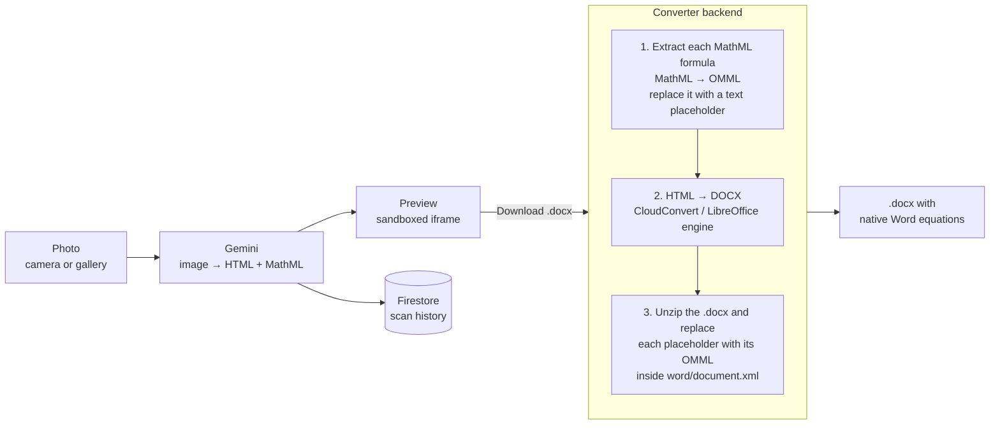

# ProfScanner

**Snap a photo of a handwritten page, get back an editable Word document with real, native equations.**

ProfScanner is a mobile-first web app built for teachers. You take a picture of a handwritten exam, an exercise sheet or a correction, and the app returns a `.docx` file you can open in Microsoft Word and keep editing. Fractions, roots, systems of equations, French and Arabic (right-to-left) text all come through. The equations are **native Word equations (OMML)**, not images and not flattened text, so you can click on them and edit them in Word's equation editor.

> **Project status: beta / proof of concept.** It works for day-to-day use on real exam sheets, but the code still carries prototype shortcuts. These are listed honestly in [Known limitations](#known-limitations) and in the [Roadmap](#roadmap). Contributions are welcome.

---

## Table of contents

- [Why this exists](#why-this-exists)
- [How it works](#how-it-works)
- [Repositories](#repositories)
- [Getting started](#getting-started)
- [Configuration reference](#configuration-reference)
- [Project structure](#project-structure)
- [What the transcription handles](#what-the-transcription-handles)
- [Known limitations](#known-limitations)
- [Security notes for self-hosting](#security-notes-for-self-hosting)
- [Roadmap](#roadmap)
- [Contributing](#contributing)
- [License](#license)
- [Author](#author)

---

## Why this exists

Turning a handwritten math sheet into a clean Word document is slow manual work: retyping text, rebuilding every fraction in the equation editor, redoing the layout. General OCR tools are bad at handwriting and worse at math. And when they do output math, it is usually LaTeX or an image, neither of which a teacher can edit in Word.

ProfScanner chains two things:

1. **A multimodal LLM** (Google Gemini) that reads the photo and writes clean HTML, with every formula encoded as **W3C MathML**.
2. **A conversion pipeline** that turns that HTML into a `.docx` and rewrites each MathML formula into **OMML**, the XML equation format Word uses natively.

Step 2 is the hard part. Word does not render MathML embedded in HTML: it flattens it into broken text. Generic HTML-to-DOCX converters (LibreOffice, most npm libraries) drop it too. Pandoc keeps the equations but loses most of the inline styling (colors, boxes, alignment) that makes the result look like the original sheet. The backend therefore runs a custom pipeline. See [How it works](#how-it-works).

---

## How it works



### Step by step

| # | Where | What happens |
|---|-------|--------------|
| 1 | Browser | The user picks or takes a photo (`<input capture="environment">`). |
| 2 | Browser → Gemini | The image is sent as base64 to `gemini-3.1-pro-preview` together with a long system prompt (in `services/apiService.ts`). The prompt requires inline CSS only, standard fonts, `dir="rtl"` for Arabic, and strict, well-formed MathML for every formula. |
| 3 | Browser | The returned HTML is rendered in an `<iframe sandbox="">`, so generated markup cannot run scripts or leak styles into the app. A title is suggested from the first words. |
| 4 | Browser → Firestore | If the user is logged in and has history enabled, the scan is saved under `users/{uid}/scans/{scanId}`. |
| 5 | Browser → backend | On download, the HTML is wrapped in a UTF-8 document and `POST`ed to the converter backend's `/convert` endpoint. |
| 6 | Backend | `mathProcessor.js` extracts every `<math>` element, converts it to OMML with [`mathml2omml`](https://www.npmjs.com/package/mathml2omml), and puts an invisible placeholder (`$$$MATH_OMML_N$$$`) in its place. |
| 7 | Backend → CloudConvert | The math-free HTML is converted to `.docx` (CloudConvert, `office` engine = LibreOffice). |
| 8 | Backend | `docxPatcher.js` opens the `.docx` (a ZIP), finds each placeholder in `word/document.xml`, including placeholders Word split across several text runs, and replaces it with the OMML while keeping the formatting of the surrounding text. |
| 9 | Backend → Browser | The patched `.docx` is streamed back and downloaded. |

The backend is documented in detail in its own repository: [ProfScan_CloudCovert_backend](https://github.com/simoosh/ProfScan_CloudCovert_backend).

---

## Repositories

| Repository | Role | Status |
|------------|------|--------|
| [`simoosh/profscanner`](https://github.com/simoosh/profscanner) *(this repo)* | React front-end, Gemini prompting, history | Active |
| [`simoosh/ProfScan_CloudCovert_backend`](https://github.com/simoosh/ProfScan_CloudCovert_backend) | HTML + MathML → DOCX converter (Node / Express) | Active |
| [`simoosh/profscan-render-backend`](https://github.com/simoosh/profscan-render-backend) | Earlier Pandoc-based converter (Docker) | Archived: kept equations, lost styling |

---

## Getting started

### Prerequisites

- **Node.js 18+** and npm
- A **Google Gemini API key**: get one for free at [Google AI Studio](https://aistudio.google.com/app/apikey). Check that the model in `services/apiService.ts` is available on your tier; switch to a Flash model if it isn't.
- A **Firebase project** (free Spark plan is enough) with:
  - **Authentication** → Email/Password and Google providers enabled
  - **Cloud Firestore** enabled
- A running instance of the **converter backend**: see [its README](https://github.com/simoosh/ProfScan_CloudCovert_backend).

### 1. Clone and install

```bash
git clone https://github.com/simoosh/profscanner.git
```

```bash
cd profscanner
```

```bash
npm install
```

### 2. Add your Gemini key

Create a `.env.local` file at the project root (it is git-ignored):

```env
VITE_GEMINI_API_KEY=your_gemini_api_key
```

> Read [Security notes](#security-notes-for-self-hosting) before deploying this anywhere public: any `VITE_*` variable ends up in the JavaScript bundle.

### 3. Point the app at your Firebase project

Replace the `firebaseConfig` object in **`firebase.ts`** with the web config of your own project (Firebase console → Project settings → Your apps → Web app).

Then apply Firestore security rules that restrict each user to their own scans:

```javascript
rules_version = '2';
service cloud.firestore {
  match /databases/{database}/documents {
    match /users/{uid}/scans/{scanId} {
      allow read, write: if request.auth != null && request.auth.uid == uid;
    }
  }
}
```

### 4. Point the app at your converter

The converter URL is currently hard-coded in **`services/apiService.ts`** (`downloadWordDoc`). Change it to your backend, for example `http://localhost:3000/convert` for local development.

### 5. Run

```bash
npm run dev
```

The dev server listens on all interfaces (`--host`), so you can open it from your phone on the same Wi-Fi network to test the camera. Note that browsers only allow camera capture on `localhost` or over HTTPS.

Production build:

```bash
npm run build
```

The static output lands in `dist/` and can be served by any static host (Netlify, Vercel, GitHub Pages, Cloudflare Pages…). The app uses a `HashRouter`, so no rewrite rules are needed.

---

## Configuration reference

| Setting | Location | Purpose |
|---------|----------|---------|
| `VITE_GEMINI_API_KEY` | `.env.local` | Gemini API key used by the browser to transcribe images |
| `MODEL_NAME` | `services/apiService.ts` | Gemini model (default `gemini-3.1-pro-preview`) |
| `firebaseConfig` | `firebase.ts` | Firebase project used for auth and history |
| Converter URL | `services/apiService.ts` → `downloadWordDoc` | Endpoint of the HTML → DOCX backend |
| `saveHistory` | `localStorage`, toggled in *Preferences* | Whether scans are saved to Firestore |
| Theme | `localStorage`, toggled in *Preferences* | Light / dark mode |

---

## Project structure

```
profscanner/
├── App.tsx                  # Routes (HashRouter) + public/protected route guards
├── firebase.ts              # Firebase init (auth + Firestore) ← used by the app
├── services/
│   └── apiService.ts        # Gemini call + prompts, Firestore CRUD, .docx download
├── context/
│   ├── AuthContext.tsx      # Email/password + Google sign-in
│   └── ThemeContext.tsx     # Dark mode
├── pages/
│   ├── Home.tsx             # Capture / upload, "math mode" toggle
│   ├── Result.tsx           # Sandboxed preview, rename, download
│   ├── History.tsx          # Saved scans
│   ├── Login.tsx, Signup.tsx
│   └── Profile.tsx, PersonalInfo.tsx, Preferences.tsx
├── components/              # Layout, header, bottom nav, modals, inputs
│
│   # Legacy, not used by the current flow (scheduled for removal):
├── firebaseConfig.ts        # Duplicate Firebase init
├── services/queueSystem.ts  # Simulated "server busy" queue (random)
└── netlify/functions/scan.ts# Old server-side Gemini call (table-based layout, no MathML)
```

---

## What the transcription handles

The prompt and pipeline were tuned on real Algerian and French school documents:

- **Math**: fractions, roots, powers and indices, sums, limits, systems of equations, intervals, inline and display equations, all as editable Word equations
- **Arabic (RTL) and French (LTR) in the same document**, including inline formulas inside Arabic sentences
- **Layout**: headings, numbered exercises, lists, tables, boxed text (rendered as one-cell tables), centered blocks
- **Pen colors, highlighting and underlining**, carried over as inline styles
- **Grading marks** (circled scores in the margin)
- **Crossed-out text is dropped**: only the final version is transcribed

Transcription quality depends first on the model. A blurry photo or messy handwriting will produce wrong or missing formulas, and no converter can fix that.

---

## Known limitations

Being upfront about the current state:

**Front-end**
- **The "math mode" toggle has no effect.** Both branches send the same prompt, and every download goes through the math-aware converter.
- **The "watch a video to unlock" screen is a placeholder.** There is no ad: it waits 2 seconds, then downloads.
- **Not an installable PWA yet**: there is no web app manifest and no service worker. It is a mobile-first single-page app.
- **The Gemini call happens in the browser**, which means the API key ships in the bundle. Fine for local use, not for a public deployment. See below.
- Single image per scan; multi-page documents have to be scanned page by page.
- Some leftover dependencies are unused (`localforage`, `match-sorter`, `sort-by`, `run`, `dotenv`).

**Converter** (details in the backend README)
- Relies on **CloudConvert**, a paid third-party API, for the HTML → DOCX step.
- The placeholder patcher has known bugs: text containing `<`, `>` or `&` in the same paragraph as an equation gets double-escaped, and two equations that end up in the same Word text run can be duplicated or produce an invalid file.
- When patching fails, the safety net returns the document **without** the equations: the placeholders are invisible (1pt transparent text), so formulas silently disappear instead of showing up as raw text.

---

## Security notes for self-hosting

- **Never deploy a build that has `VITE_GEMINI_API_KEY` set to your own key on a public URL.** Vite inlines every `VITE_*` variable into the JavaScript bundle; anyone can open DevTools and copy it. Until a proxy or bring-your-own-key mode lands (see Roadmap), either keep the app private or restrict the key in Google Cloud Console (HTTP referrer restriction + API restriction to the Generative Language API).
- **The Firebase web `apiKey` is not a secret.** It identifies the project, and access is enforced by Firestore security rules, so make sure you apply rules like the ones above.
- **Protect your converter.** The backend has no authentication and allows any origin. If it holds a paid CloudConvert key, anyone who finds the URL can spend your credits. Restrict CORS to your front-end origin and add rate limiting before exposing it.
- AI-generated HTML is always rendered in an `<iframe sandbox="">` with no permissions. Keep it that way.

---

## Roadmap

The goal is a **100% free, fully open-source** pipeline with no paid third-party service in the loop.

- [ ] **Drop CloudConvert**: generate the `.docx` directly (in the browser or in Node), writing OMML straight into the document. This removes the placeholder/patching step and its bugs.
- [ ] **Extract the converter into a standalone library**: HTML (inline CSS, RTL) + MathML → DOCX with native equations, usable on its own from npm.
- [ ] **Bring-your-own-key**: each user pastes their own free Gemini key, stored locally on their device. No shared key, no backend needed for transcription.
- [ ] **Optional cloud**: local history (IndexedDB) by default, Firebase only if configured.
- [ ] Real PWA: manifest, service worker, offline history.
- [ ] Multi-page scans merged into one document.
- [ ] LaTeX input (`$…$`) in addition to MathML.
- [ ] Remove dead code and unused dependencies; move hard-coded URLs and config to environment variables.
- [ ] Add a license (see below).

---

## Contributing

Issues and pull requests are welcome, especially:

- **Failing documents**: if a scan produces a broken or wrong `.docx`, open an issue with the photo (if you can share it) and the generated HTML. These are the most useful test cases.
- Improvements to the converter's DOCX/OMML handling.
- Translations of the UI (currently French).

Before opening a PR, make sure `npm run build` passes (it runs the TypeScript check).

---

## License

**No license has been chosen yet.** Until a `LICENSE` file is added, the code is technically "all rights reserved", even though it is publicly visible. One will be added soon.

---

## Author

Built by **[simoosh](https://github.com/simoosh)** (SAHNOUNE Slimane).
